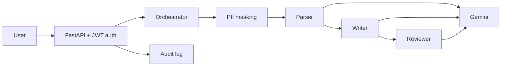

# Enterprise AI Resume Generator

A FastAPI backend where three AI agents work together to turn a job description and a candidate's real facts into tailored resume content. It includes login with roles, an audit trail, PII masking, an MCP tool server and automated tests.

> The Writer agent may only use facts the candidate provides. It is told never to invent employers, numbers or results, and a Reviewer agent checks for unsupported claims.

## How it works



1. **Parser agent** reads the job description and returns the job title, required skills, nice-to-have skills and ATS keywords.
2. **Writer agent** writes a summary, key skills and highlights using only the candidate's real facts, and lists missing skills.
3. **Reviewer agent** gives a match score, lists missing keywords, flags unsupported claims and suggests honest improvements.
4. The **orchestrator** runs the agents in order, times each step and reports which step failed.

## Features

- Multi-agent pipeline with an orchestrator
- JWT login with role-based access (admin and user)
- Passwords hashed with bcrypt, secrets kept in `.env`
- PII masking: emails and phone numbers are replaced before text reaches the model, and the candidate name is not sent at all
- Audit trail of who did what and when, with no personal content in the logs
- Retry and fallback model for temporary Gemini errors
- MCP server exposing three tools
- 19 automated tests that use a fake AI

## Tech stack

Python 3.11, FastAPI, Pydantic, Google Gemini (`google-genai`), PyJWT, bcrypt, MCP Python SDK (version 1), pytest.

## Project structure

```
resume-agent/
├── app/
│   ├── main.py          # API routes
│   ├── models.py        # request and response models
│   ├── agents.py        # Parser, Writer and Reviewer agents
│   ├── orchestrator.py  # runs the agents in order
│   ├── llm.py           # Gemini wrapper with retry and fallback
│   ├── auth.py          # JWT login and roles
│   ├── privacy.py       # PII masking
│   └── audit.py         # logging and audit trail
├── tests/               # automated tests (fake AI)
├── mcp_server.py        # MCP server with three tools
├── mcp_client_demo.py   # demo client for the MCP server
├── try_llm.py           # quick Gemini connection check
├── conftest.py
├── pytest.ini
└── requirements.txt
```

## Setup (Windows PowerShell)

```
git clone https://github.com/mvsprudhvi2023-lang/resume-agent.git
cd resume-agent
python -m venv venv
.\venv\Scripts\Activate.ps1
pip install -r requirements.txt
```

Create a `.env` file in the main folder. **Never commit this file.**

```
GEMINI_API_KEY=your_key_here
GEMINI_MODEL=gemini-3.5-flash
GEMINI_FALLBACK_MODEL=gemini-3.5-flash-lite
JWT_SECRET=a_long_random_string
ADMIN_PASSWORD=choose_a_password
USER_PASSWORD=choose_a_password
```

Get a free Gemini key at https://aistudio.google.com/app/apikey. Model names change over time, so update them in `.env` if Google retires one. Generate a secret with:

```
python -c "import secrets; print(secrets.token_hex(32))"
```

## Run the API

```
uvicorn app.main:app --reload
```

Open http://127.0.0.1:8000/docs, click **Authorize**, and log in as `analyst` (password from `USER_PASSWORD`) or `admin` (password from `ADMIN_PASSWORD`).

## Endpoints

| Method | Path | Access | Purpose |
|---|---|---|---|
| GET | `/health` | public | Service check |
| POST | `/login` | public | Returns a JWT token |
| POST | `/parse-job` | logged in | Parser agent only |
| POST | `/generate-resume` | logged in | Full pipeline: parse, write, review |
| POST | `/resumes` | logged in | Save a resume request |
| GET | `/resumes` | admin | List saved requests |
| GET | `/resumes/{id}` | admin | View one saved request |

Example body for `/generate-resume`:

```json
{
  "full_name": "Jane Doe",
  "job_description": "We are hiring an AI Business Analyst. Must know Python, SQL and Power BI.",
  "skills": ["Python", "SQL"],
  "experience_years": 3,
  "achievements": ["Built a small data dashboard"]
}
```

## Run the tests

```
python -m pytest -q
```

The tests use a fake AI, so they are fast, free and need no API key.

## MCP server

`mcp_server.py` exposes three tools: `mask_pii_text`, `skill_match` and `parse_job`. Try it with the demo client:

```
python mcp_client_demo.py
```

## Known limitations

- Resume requests and demo users are stored in memory, so data resets when the server restarts. A real system would use a database.
- PII masking uses patterns, so it catches emails and phone numbers but not names or addresses.
- The match score is a model estimate, not a real ATS measurement.
- The AI can make mistakes, so a person should review every generated resume.
- No HTTPS, refresh tokens or rate limiting yet.
- The MCP SDK is pinned to version 1. Migrating to version 2 is a planned step.

## Roadmap

Database storage, refresh tokens and rate limiting, a dedicated PII detection tool such as Microsoft Presidio, an evaluation set of real examples, and migration to the MCP SDK version 2.